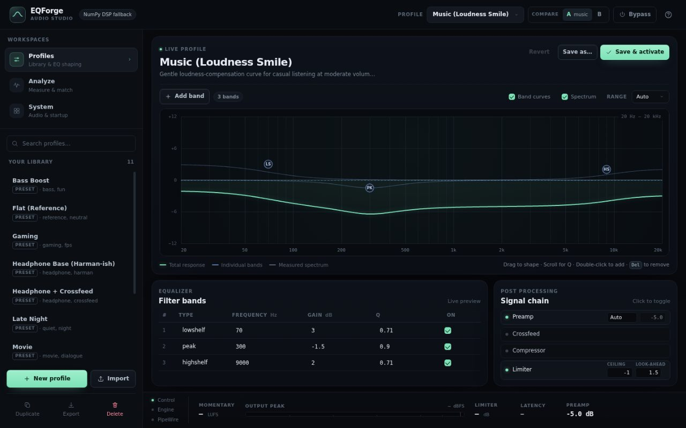
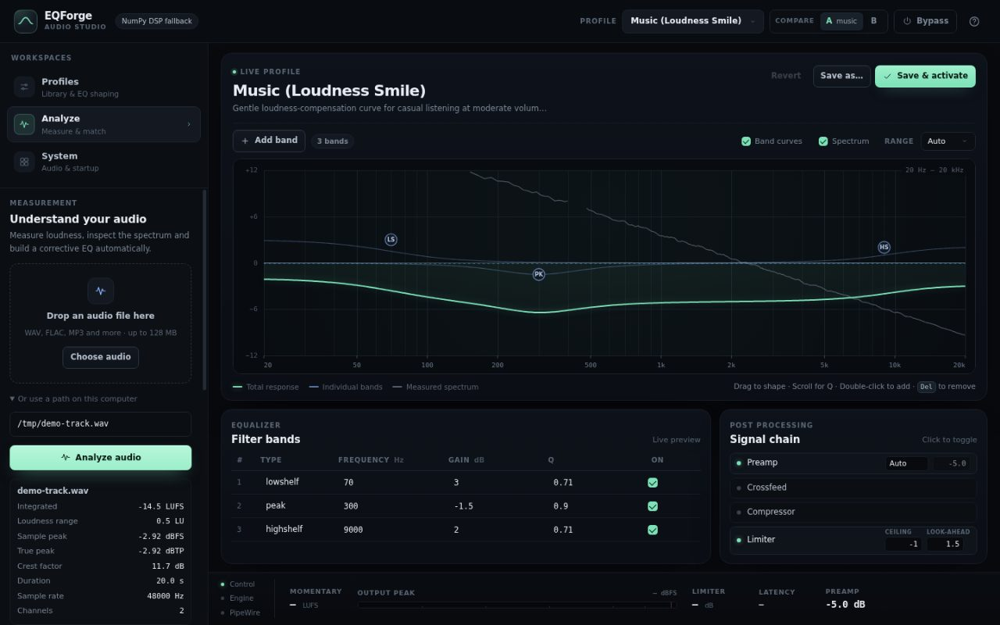
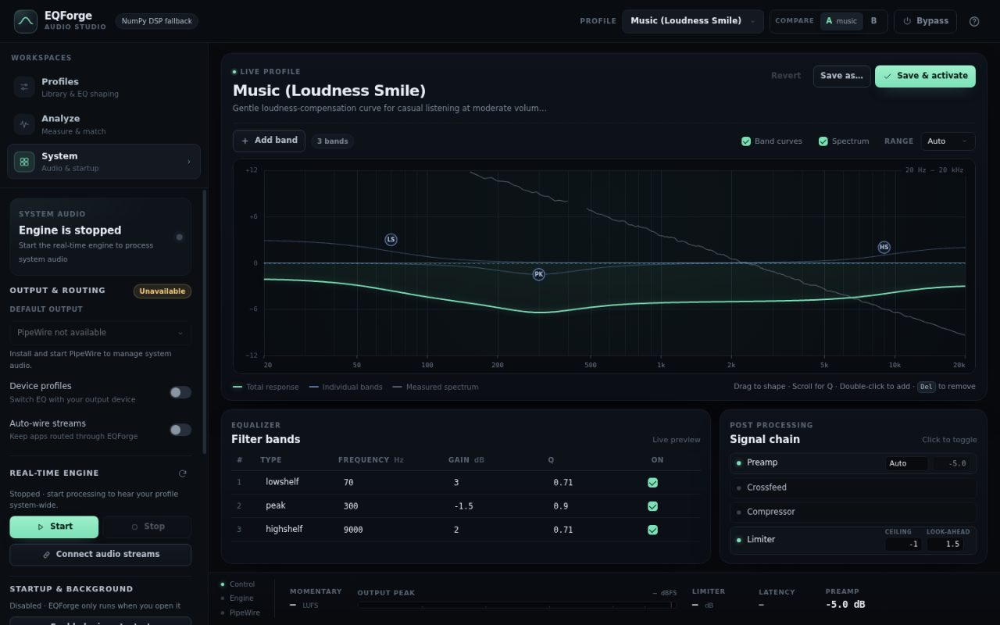
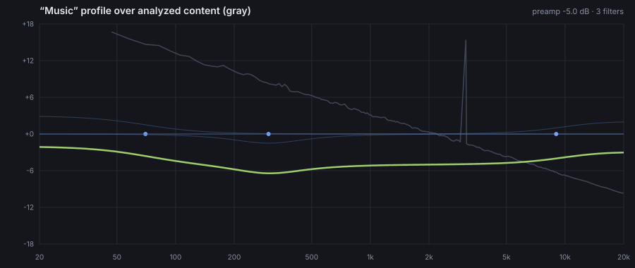

<div align="center">

# EQForge

**Profile-driven smart audio processing for Linux.**

A native C11 DSP core with a real-time-safe contract, first-class PipeWire
integration, measurement-grade analysis, and a control plane you can script.

[](#licensing)
[](https://github.com/erfanjaster/eqforge)
[](#requirements)
[](#requirements)
[](#set-it-once-self-maintaining-system-audio)
[](#architecture)

</div>

<table>
  <tr>
    <td width="50%">
      <a href="demo/studio-profiles.jpg"></a>
      <sub><b>Profiles</b> — searchable library, an interactive EQ curve and the post-processing chain.</sub>
    </td>
    <td width="50%">
      <a href="demo/studio-analysis.jpg"></a>
      <sub><b>Analyze</b> — loudness and spectrum measurements, advisor findings and target-matched EQ.</sub>
    </td>
  </tr>
  <tr>
    <td width="50%">
      <a href="demo/studio-system.jpg"></a>
      <sub><b>System</b> — output routing, the real-time engine, startup services and diagnostics.</sub>
    </td>
    <td width="50%">
      
      <sub><b>Analysis overlay</b> — a shipped profile drawn over the measured spectrum of your content.</sub>
    </td>
  </tr>
</table>

---

## Contents

- [What EQForge is](#what-eqforge-is)
- [Architecture](#architecture)
- [Features](#features)
- [Install](#install)
- [Set it once: self-maintaining system audio](#set-it-once-self-maintaining-system-audio)
- [The one-minute tour](#the-one-minute-tour)
- [Configuration](#configuration)
- [Command reference](#command-reference)
- [Requirements](#requirements)
- [Development](#development)
- [Direction](#direction)
- [Licensing](#licensing)
- [Support the project](#support-the-project)

---

## What EQForge is

EQForge is a system-wide equalizer and audio processor for Linux. It is built
the way audio software should be:

> **The real-time path never allocates, never locks, and never touches Python**
> — while everything *around* audio (profiles, analysis, automation, UI) is
> flexible, scriptable and script-friendly.

That separation is the whole design. A C11 core with no runtime dependencies
does the sample-level work behind a fixed memory budget; a Python control plane
does the human-level work — validating profiles, measuring files, resolving
inheritance, importing other tools' corrections, serving the GUI, and keeping
the audio graph wired. The two meet at exactly one place: a resolved
`dsp-config` JSON document that both sides validate independently.

Nothing reaches the DSP core without passing two validators. A rejected
configuration is a reported error, not a click, a dropout, or silence.

## Architecture

```
        ┌────────────────────────────────────────────────────────────┐
        │                        control plane                       │
        │  eqforge CLI · daemon (JSON-RPC + GUI server) · advisor    │
        │  profiles & inheritance · importers · BS.1770 analysis     │
        └──────────────┬─────────────────────────────┬───────────────┘
                       │ resolved dsp-config JSON     │
        ┌──────────────▼──────────────┐   ┌──────────▼───────────────┐
        │   real-time hosts (native)  │   │  offline renderer (ctypes)│
        │  PipeWire SPA filter module │   │  analyze · apply · batch  │
        │  eqforge-rt (JACK client)   │   │  normalize · dither       │
        └──────────────┬──────────────┘   └──────────┬───────────────┘
                       │                             │
        ┌──────────────▼─────────────────────────────▼───────────────┐
        │           libeqforge — C11 DSP core (RT-safe, no deps)     │
        │   biquad EQ · compressor · look-ahead true-peak limiter    │
        │   crossfeed · FIR convolver · K-weight meters · JSON cfg   │
        └─────────────────────────────────────────────────────────────┘
```

Core limits are compile-time constants, not runtime surprises
(`core/include/eqforge/types.h`): **16 channels**, **64 bands per channel**,
**8192 FIR taps per channel**, 8192-sample blocks.

## Features

**Equalizer** — up to 64 bands per channel: peaking, low/high shelves (6 &
12 dB/oct), low/high-pass, band-pass, notch, all-pass. Per-channel filters,
smooth zipper-free parameter ramps, instant bypass and A/B slots.

**Profiles** — human-readable JSON with schema validation, format versioning
and migration, and true inheritance (`flat → headphone-base → my-sonnet-1`).
Import AutoEQ, Room EQ Wizard, EqualizerAPO and plain CSV correction files.
Export self-contained resolved profiles for sharing. Diff any two profiles by
what actually reaches the engine.

**Analysis** — ITU-R BS.1770-4 integrated/momentary/short-term LUFS, EBU Tech
3342 loudness range, 4×-oversampled true peak (BS.1770 Annex 2), crest factor,
clipping and DC detection, 1/3-octave band balance, spectral flatness/centroid,
and narrowband resonance detection.

**Smart advisor** — real signal processing, not marketing: auto-preamp from
worst-case EQ headroom, clipping-risk prediction for a (profile × content)
pair, resonance → notch suggestions, target-curve matching (Harman) with
conservative gain-limited suggestions, loudness normalization plans, and
plain-English warnings carrying machine-readable actions.

**Linux-native** — a compiled PipeWire SPA filter node (`libeqforge-filter.so`)
with hot-reloading config, plus a JACK/PipeWire-JACK real-time host with a
control socket. Device and stream discovery from the PipeWire graph, rule-based
auto-switching per device (Bluetooth headphones plug in → your headphone
profile activates), desktop notifications, systemd user units, XDG paths.

**Self-maintaining** — login units for both the host and the daemon, an
event-driven watcher that re-links application streams through the processor in
tens of milliseconds when a player restarts, and an optional WirePlumber policy
that routes new streams through the processor from their first sample. Crash of
the real-time host is recovered automatically. See
[below](#set-it-once-self-maintaining-system-audio).

**File processing** — `eqforge apply` / `batch` render files through the same
native chain used in real time: bit-identical engine behavior, latency
compensation, two-pass LUFS normalization with true-peak ceiling, TPDF dither
on bit-depth reduction, metadata preservation, MP3/M4A/OPUS via ffmpeg.

**Interfaces** — a designed CLI (`eqforge …`, everything scriptable, `--json`
everywhere) and a fast local web GUI (no frameworks, no CDN): draggable EQ
canvas with per-band ghosts and spectrum overlay, live meters over SSE,
profile/device management, A/B and bypass.

**Reliability** — every layer validates: profile schema with errors *and*
warnings, native config re-validation, safe fallbacks (numpy engine when the
core can't load), corrupt-config quarantine, stale-socket recovery, and
`eqforge doctor` end-to-end self-tests.

## Install

One script compiles and installs EQForge, refreshes an existing installation,
and supports rollback:

```sh
curl -fsSL https://raw.githubusercontent.com/erfanjaster/eqforge/main/scripts/eqforge.sh -o eqforge.sh
# Check that this prints exactly: #!/usr/bin/env bash
head -n 1 eqforge.sh
bash eqforge.sh --install
```

`--install` builds the native DSP core, installs the Python app and its
runtime dependencies into a private environment, adds an EQForge desktop
launcher, verifies the install, and enables the audio services when the
required JACK/PipeWire pieces and user systemd session are available. Start the
GUI from your applications menu or run `~/.local/bin/eqforge gui`.

`--update` updates an existing install without prompting and preserves its
autostart choice. `--install` also repairs/rebuilds an existing install and
sets up autostart when supported. Both flags assume your consent to the
requested install/update; they do not use `sudo` or install OS packages. The
install needs Python 3.10+ with `venv`/`pip`, `make`, and a C compiler;
optional real-time and PipeWire modules need their development headers. See
[installation requirements](docs/installation.md#requirements) if a build
prerequisite is missing.

Use the **Raw** download above, not GitHub's `/blob/` file-view page. Saving
that page downloads HTML; renaming it to `.sh` does not make it a shell script.
If the first line is HTML, do not run the file.

Then, or by hand from a checkout:

```sh
# 1. build the native core (needs gcc + make; ~5 seconds)
make -C core

# 2. install the Python control plane (editable, user scope)
python3 -m pip install --user -e .

# 3. verify the install — engine, native hosts, JACK transport, PipeWire tools
eqforge doctor

# 4. analyze and process a file
eqforge analyze song.flac
eqforge apply bass-boost song.flac song-processed.flac

# 5. browse built-in starting points and inspect their curves
eqforge list-profiles
eqforge show all-round
eqforge set-profile u-shape       # also: v-shape, warm, bright, relaxed

# 6. system-wide processing (PipeWire session required)
eqforge system setup && eqforge system start
eqforge set-profile gaming
eqforge gui            # browser UI: EQ canvas, meters, devices
```

Packaging for distributions lives in `packaging/` (desktop entry, systemd
units, PipeWire/WirePlumber config, `install.sh`). Full instructions, including
building the PipeWire SPA module and the JACK host, are in
[docs/installation.md](docs/installation.md).

## Set it once: self-maintaining system audio

System audio normally needs a human: start the host, wire it into the graph,
and re-wire every time a player restarts a stream. EQForge does that itself.

```sh
eqforge system autostart on      # one command; the last one you need to type
```

This writes two **per-install** systemd user units and enables them:

| Unit | Runs | Supervision |
|---|---|---|
| `eqforge-rt.service` | the real-time host, wrapped in `pw-jack` when PipeWire provides JACK | `Restart=on-failure`, `RestartSec=2`, `Nice=-11` |
| `eqforge-daemon.service` | the control daemon with `--auto-wire` | `Restart=on-failure`, ordered after PipeWire, WirePlumber and the host |

Units are generated from *your* install, so paths are absolute and correct:
your venv interpreter, your in-tree or packaged host binary, `PYTHONPATH` for a
checkout that was never pip-installed, and `XDG_RUNTIME_DIR=%t` so the control
socket stays where the CLI looks for it.

Then, continuously and without intervention:

- **Streams are re-linked automatically.** A watcher in the daemon compares a
  fingerprint of the PipeWire graph each tick; when an application restarts a
  stream and it comes back wired straight to the sink, the daemon moves it back
  through the processor — typically within a second or two. A tick where
  nothing changed costs zero `pw-link` calls.
- **A crashed host comes back.** systemd restarts it; `Restart=on-failure`
  (rather than `always`) means a deliberate `eqforge system stop` stays stopped
  instead of being fought.
- **The host loads the right JACK.** The unit bakes in `pw-jack` when
  `pipewire-jack` is installed, which is what stops the classic failure where a
  host built against jack2's headers finds no server and exits with JACK status
  17 while PipeWire is running fine.

```sh
eqforge system autostart status  # unit files, enabled/active state, auto-wire flag
eqforge system wire              # do one wiring pass by hand (same code path)
eqforge system autostart off     # disable, remove the units, clear the flag
```

Automatic graph rewriting is **off by default**. The daemon is spawned
implicitly by ordinary commands (`eqforge status`), and silently rewiring
someone's audio graph from there would be a nasty surprise — so it only rewires
when you have asked for it, and that preference is persisted.

### Processed from the first sample, not the second one

Re-routing a stream is always slightly late: by the time anyone can move it,
the player has already started feeding the sink. Three windows existed and all
three are closed:

| Window | Was | Now |
|---|---|---|
| 0 – 2 s | the graph was polled every 2 s, so a re-routed stream could play unprocessed for up to two seconds | the daemon reacts to PipeWire registry events (`pw-dump -m`): **~30–60 ms**, coalesced into one pass per playback start |
| ~0 – 60 ms | even an instant reaction happens *after* the stream exists | `eqforge system always-on on` installs a WirePlumber rule that creates new streams on EQForge's inputs — **zero** unprocessed samples |
| 0 – 500 ms | a host or filter node that started before `active-dsp.json` existed ran as pass-through until the next config poll | the SPA node loads its config at creation and looks for a missing file 10×/s; `eqforge-rt` retries ~5×/s until it appears |

```sh
eqforge system always-on on --now   # policy: streams start on EQForge
eqforge system always-on status     # is it installed, is the target live?
eqforge status                      # "graph events" line: events vs. polling
```

The poll remains as the safety net (default-sink metadata, a dead monitor, a
shadowing policy), so nothing degrades if events are unavailable.

Details: [docs/pipewire-integration.md](docs/pipewire-integration.md).

## The one-minute tour

```console
$ eqforge suggest vocal-demo.wav --target harman-overear --save-as auto-match
  Target: harman-overear
  rms deviation  4.2 dB
  max deviation  8.9 dB

  Suggested corrective filters:
  type      freq     gain    q
  ----------------------------
  lowshelf  63 Hz    -4.2    0.71
  peak      250 Hz   -2.8    1.3
  peak      6300 Hz  +3.1    1.3
  saved as profile auto-match → ~/.config/eqforge/profiles/auto-match.json

$ eqforge show auto-match
  Auto-match (harman-overear)
  +15.0 |
   ...  |            **
   +0.0 |------*****------***********------------
   ...  |  *****                *****
  -15.0 |***                        ************
        +---------------------------------------
         20   50   100  200  500  1k   2k   5k  10k  20k

$ eqforge apply auto-match --normalize -16 vocal-demo.wav final.flac
  ✓ final.flac  (native engine, 71.3× realtime, normalized +4.2 dB)
```

## Configuration

EQForge is configured with two kinds of JSON document, and it is worth keeping
them distinct:

| Document | What it is | Who writes it |
|---|---|---|
| **Profile** (`~/.config/eqforge/profiles/*.json`) | A processing chain plus metadata and matching rules. Inheritable, shareable, version-controlled. | You (or `eqforge new` / `import` / `suggest --save-as`) |
| **Resolved dsp-config** (`~/.config/eqforge/active-dsp.json`) | The fully-resolved contract handed to the native engine. | EQForge — **do not hand-edit** |
| **App config** (`~/.config/eqforge/config.json`) | Slots, bypass, auto-switch rules, GUI, notifications, auto-wire. | EQForge (atomic write), editable by hand |

### Files & locations (XDG)

| Path | Purpose |
|---|---|
| `~/.config/eqforge/config.json` | user configuration |
| `~/.config/eqforge/profiles/*.json` | user profiles (shadow builtins by id) |
| `~/.config/eqforge/active-dsp.json` | resolved dsp-config for native hosts |
| `~/.local/share/eqforge/imports/` | import scratch and history |
| `~/.local/state/eqforge/logs/eqforge.log` | rotating log (2 MB × 3) |
| `$XDG_RUNTIME_DIR/eqforge/daemon.sock` | daemon JSON-RPC socket (0600) |
| `$XDG_RUNTIME_DIR/eqforge/rt.sock` | real-time host control socket (0600) |
| `$XDG_RUNTIME_DIR/eqforge/gui.port` | current GUI port |

Environment overrides: `EQFORGE_LIB`, `EQFORGE_RT`, `EQFORGE_CONFIG`,
`EQFORGE_DEBUG=1`, `NO_COLOR=1`.

### A profile, annotated

This document is a complete, valid profile — it passes `eqforge validate` with
no errors and no warnings, so you can copy it into
`~/.config/eqforge/profiles/hd650.desk.json` as a starting point.

```json
{
  "format": "eqforge.profile",
  "format_version": 2,
  "id": "hd650.desk",
  "name": "HD650 — Desk",
  "description": "Per-unit correction for a Sennheiser HD650 with a mild late-night tilt. Inherits the shared headphone base and appends unit-specific bands.",
  "tags": ["headphone", "sennheiser", "hd650", "desk"],
  "author": "erfanjaster",

  "extends": ["headphone-base"],

  "preamp": { "mode": "auto" },

  "eq": {
    "filters_op": "append",
    "filters": [
      { "type": "highpass",  "freq": 28,   "q": 0.71,
        "name": "sub-sonic guard" },
      { "type": "peak",      "freq": 105,  "gain_db": 5.1, "q": 1.10,
        "name": "bass body" },
      { "type": "notch",     "freq": 4210, "q": 12.0,
        "name": "measured driver resonance" },
      { "type": "peak",      "freq": 2800, "gain_db": -1.2, "q": 3.0,
        "channel": 1, "name": "right-ear only" },
      { "type": "highshelf", "freq": 8500, "gain_db": -1.8,
        "use_q": false, "slope": 0.71, "name": "air, minus sibilance" }
    ]
  },

  "crossfeed":  { "enabled": true, "level_db": -6.5, "fc_hz": 700 },
  "compressor": { "enabled": false },
  "limiter": {
    "enabled": true, "ceiling_db": -1.0,
    "attack_ms": 5, "release_ms": 60, "lookahead_ms": 1.5, "knee_db": 3
  },

  "loudness": { "target_lufs": -16.0, "true_peak_db": -1.0 },

  "matching": {
    "devices": [
      { "profile": "hd650.desk",
        "match": { "name": "*HD650*", "kind": "usb" }, "priority": 20 }
    ],
    "apps": [
      { "profile": "voice", "match": { "binary": "*zoom*" }, "priority": 5 }
    ]
  }
}
```

**Identity and inheritance**

| Key | Notes |
|---|---|
| `format` | Always `"eqforge.profile"`. |
| `format_version` | Currently **2**. v1 documents (flat `filters`, `preamp_db`, `device_match`) are migrated automatically on load. |
| `id` | `[A-Za-z0-9][A-Za-z0-9._-]*`, ≤128 chars. Dot-separated ids are a convention, not a hierarchy: `hd650.desk` is just a name. A user profile shadows a builtin with the same id. |
| `extends` | Profile ids to inherit, in order; max chain depth 8, cycles rejected. Objects deep-merge; lists replace unless told otherwise. |
| `name`, `description`, `author`, `tags` | Display metadata; `tags` drive GUI search. |
| `created`, `modified` | Unix seconds, set by the store — omitted here on purpose. |

**Gain staging**

| Key | Notes |
|---|---|
| `preamp.mode: "auto"` | Computes `−Σ(positive enabled gains)`, so the EQ alone can never exceed unity at any frequency. This is the default and the safe choice. |
| `preamp.mode: "manual"` + `preamp.gain_db` | Fixed trim, −60…+60 dB. Use when you are matching a measured level rather than protecting headroom. |
| `limiter` | Look-ahead true-peak limiter, on by default: `ceiling_db` −60…0, `attack_ms` 0.1…500, `release_ms` 1…10000, `lookahead_ms` 0…50, `knee_db` 0…24. |
| `loudness.target_lufs` | Used by offline `apply`/`batch` for two-pass normalization (−70…0). |

**Chain stages** — processed in this order: `preamp → eq → crossfeed →
convolver → compressor → limiter`.

| Key | Notes |
|---|---|
| `crossfeed` | Headphone virtualization (Bauer-style). `level_db` −30…0, `fc_hz` 50…4000. |
| `compressor` | Feed-forward. `ratio` 1…100, `threshold_db` −100…0, plus `knee_db`, `attack_ms`, `release_ms`, `makeup_db`, `stereo_link`, `rms_detect`. |
| `convolver` | FIR correction. Supply `ir` (inline taps) **or** `ir_file` (WAV, decoded and peak-normalized at resolve time, ≤8192 taps/channel). `enabled: true` with neither is a validation error. |

**Matching rules** — device/app-triggered profile switching:

```json
{ "profile": "<id>", "match": { "<identity-key>": "<glob-or-substring>" },
  "priority": 20 }
```

Device identity keys: `name`, `node_name`, `description`, `kind` (`bluetooth`,
`usb`, `hdmi`, `headphones`, `speakers`, `other`), `alsa_card`, `bluez_address`,
`bluez_name`, `serial`, `vendor`. App identity keys: `name`, `binary`,
`node_name`. Values containing `*` or `?` are globs; otherwise case-insensitive
substring. All keys in one rule must match (AND); highest `priority` wins, then
most specific. Rules may also live globally in `config.json` — the two sets are
merged.

### Filter reference

| Field | Type | Range / values |
|---|---|---|
| `type` | string | `peak` `lowshelf` `highshelf` `lowshelf12` `highshelf12` `lowpass` `highpass` `bandpass` `notch` `allpass` |
| `freq` | number | 1 … 1 000 000 Hz (clamped to Nyquist at design time) — out of range is an **error** |
| `gain_db` | number | −48…48; above 24 **warns**; ignored by pass/notch/allpass types (setting it there warns) |
| `q` | number | 0.0001 … 200 |
| `use_q` | bool | Default: true for peak/pass, false for shelves |
| `slope` | number | Shelf slope S ∈ (0.05, 1] when `use_q` is false |
| `enabled` | bool | Default true; disabled bands are dropped at resolve time |
| `channel` | `"all"` \| int | Per-channel filtering, 0-based, 0…15 |
| `name` | string | Optional label, shown in the GUI and tables |

Bands belong under `"eq": { "filters": [...] }`. A band list parked at the top
level (or under `bands`, `filter`, `equalizer`, …) is the single easiest way to
lose an entire EQ with no error message, so the validator specifically warns
about it. Unknown keys elsewhere are preserved and ignored — newer profiles
stay loadable by older versions.

### Inheritance

```
flat                 safety limiter, nothing else
└── headphone-base   gentle Harman-ish tilt
    └── hd650.desk           per-unit correction  ← the profile above
        └── hd650.late-night adds compression for the apartment
```

`eq.filters_op` controls how a child's band list combines with its parents':

- `"replace"` (default) — the child's list wins outright
- `"append"` — parent bands first, then the child's

A subtlety worth knowing: **omitting** `filters` means "inherit"; an explicit
`"filters": []` means "replace with nothing". EQForge preserves that
distinction when it rewrites profiles, so a child that only tweaks the preamp
cannot silently discard every inherited band.

### What the engine actually receives

`eqforge show hd650.desk --resolved` prints the exact document the native core
parses. This is verbatim output (comments added here for explanation — they are
not part of the format):

```jsonc
{
  "preamp_db": -9.6,                     // auto: -(4.5 + 5.1) dB of positive gain
  "eq": {
    "filters": [                       // 8 = 3 inherited from headphone-base + 5 of its own
      {"type": "lowshelf", "freq": 105.0, "gain_db": 4.5, "q": 0.9, "enabled": true, "use_q": false, "slope": 0.71},
      {"type": "peak", "freq": 2800.0, "gain_db": -1.0, "q": 1.5, "enabled": true},
      {"type": "highshelf", "freq": 9500.0, "gain_db": -1.5, "q": 0.7, "enabled": true, "use_q": false, "slope": 0.71},
      {"type": "highpass", "freq": 28.0, "gain_db": 0.0, "q": 0.71, "enabled": true},
      {"type": "peak", "freq": 105.0, "gain_db": 5.1, "q": 1.1, "enabled": true},
      {"type": "notch", "freq": 4210.0, "gain_db": 0.0, "q": 12.0, "enabled": true},
      {"type": "peak", "freq": 2800.0, "gain_db": -1.2, "q": 3.0, "enabled": true, "channel": "1"},
      {"type": "highshelf", "freq": 8500.0, "gain_db": -1.8, "q": 1.0, "enabled": true, "use_q": false, "slope": 0.71}
    ]
  },
  "post_gain_db": 0.0,
  "crossfeed": {"enabled": true, "level_db": -6.5, "fc_hz": 700.0},
  "compressor": {"enabled": false, "threshold_db": -18.0, "ratio": 3.0, "knee_db": 6.0, "attack_ms": 10.0, "release_ms": 120.0, "makeup_db": 0.0, "stereo_link": true, "rms_detect": false},
  "limiter": {"enabled": true, "ceiling_db": -1.0, "attack_ms": 5.0, "release_ms": 60.0, "lookahead_ms": 1.5, "knee_db": 3.0}
}
```

Transformations from profile to dsp-config: inheritance resolved; disabled
filters dropped; `preamp.mode: "auto"` replaced by the computed headroom value;
`channel: 1` serialized as the string `"1"`; every stage present with concrete
defaults (note the disabled compressor, fully specified); `convolver.ir_file`
inlined as taps. `matching`, `loudness` and metadata stay in the Python layer —
the engine does not need them. The C core re-validates this document
independently and refuses unsafe values.

### Application config

`~/.config/eqforge/config.json` — rewritten atomically (tmp + rename). A
corrupt file is quarantined to `config.broken.bak` and defaults are used, so
the daemon always starts.

```json
{
  "profile_a": "hd650.desk",
  "profile_b": "flat",
  "active_slot": "A",
  "bypass": false,

  "auto_switch": true,
  "rules": [
    { "profile": "gaming",
      "match": { "binary": "steam*", "name": "*Game*" },
      "priority": 10 },
    { "profile": "hd650.desk",
      "match": { "bluez_address": "AA:BB:CC:DD:EE:FF" },
      "priority": 20 }
  ],

  "auto_wire": true,

  "gui": { "port": 0, "open_browser": true },
  "notifications": true
}
```

| Key | Default | Meaning |
|---|---|---|
| `profile_a` / `profile_b` | `"flat"` | A/B slot assignments, persisted across restarts |
| `active_slot` | `"A"` | Which slot is live |
| `bypass` | `false` | Engine bypass state |
| `auto_switch` | `false` | Allow device/app rules to switch profiles |
| `rules` | `[]` | Global matching rules, merged with per-profile rules |
| `auto_wire` | `false` | Let the daemon re-link streams through the host automatically. `eqforge system autostart on` sets this; the daemon flag `--auto-wire` overrides it |
| `gui.port` | `0` | Fixed GUI port (`0` = ephemeral) |
| `notifications` | `true` | Desktop notifications on switches and warnings |

### Validation

```sh
eqforge validate hd650.desk            # by id
eqforge validate ./my-profile.json     # by path
```

Reports **errors** (reject: unknown filter type, out-of-range values, bad id,
circular or too-deep `extends`, limiter ceiling above 0 dB, malformed matching
rule, convolver enabled with no impulse response) and **warnings** (load
anyway: boosts above 24 dB, `gain_db` on a filter type that ignores it, a band
list parked where the model will never read it).

The normative specification is [docs/profile-format.md](docs/profile-format.md);
`eqforge/profiles/schema.py` implements it.

## Command reference

| Group | Commands |
|---|---|
| **Analyze & render** | `analyze` · `apply` · `batch` · `suggest` · `synth` |
| **Profiles** | `list-profiles` · `show` · `new` · `import` · `export` · `diff` · `validate` · `delete` |
| **Live session** | `status` · `devices` · `streams` · `set-profile` · `bypass` · `ab` |
| **System** | `system setup\|start\|stop\|status\|wire\|autostart` · `daemon start\|stop\|restart\|status\|run` · `gui` |
| **Meta** | `doctor` · `version` |

Global flags: `--json` (machine-readable output on every command), `--verbose`,
`--quiet`. The daemon also speaks JSON-RPC over a Unix socket and HTTP, with an
SSE event stream — see [docs/cli.md](docs/cli.md) and
[docs/configuration.md](docs/configuration.md).

## Requirements

- Linux with PipeWire (recommended) or JACK; Python ≥ 3.10
- `gcc` and `make` for the native core (or fall back to the numpy engine)
- Python: `numpy`, `scipy`, `soundfile` (pip or distro packages)
- Optional: `ffmpeg` (MP3/M4A/OPUS), PipeWire CLI tools (`pw-dump`, `pw-link`),
  `pipewire-jack` (provides `pw-jack`, needed when the host is built against
  jack2's headers)

## Development

```sh
make -C core          # libeqforge — needs only a C compiler + make
make                  # core, plus the PipeWire module and the JACK host;
                      # each optional component is skipped cleanly when its
                      # headers (libspa-0.2 / libjack) are not installed
make test             # test-core, test-module, test-rthost, test-python
make lint             # pyflakes over eqforge/ and tests/
```

Current state of the tree, as measured by those commands:

- **C core** — `make test-core`: **1181 checks, 0 failures** across biquad
  design/processing, EQ, compressor, limiter, crossfeed (including its measured
  response), convolver, meters, and chain behavior.
- **Python** — `make test-python`: **311 tests passing** (parity against the
  native engine, analysis, profiles and inheritance, CLI, daemon RPC, wiring,
  autostart, rt-host launch and supervision).

Three documents record how this codebase was brought to its current state, and
they are worth reading if you are evaluating it seriously:

| Document | What it is |
|---|---|
| [AUDIT_REPORT.md](AUDIT_REPORT.md) | An independent audit of the initial commit: what was inspected, what was measured, what was found broken |
| [REPAIR_LOG.md](REPAIR_LOG.md) | Every finding, what changed, and **how the change was proven** — each claim names a command, a number, or a test file |
| [TEST_RESULTS.md](TEST_RESULTS.md) | Final measured results, each produced by a command in the document |

The governing rule in those documents is worth stating plainly, because it
shapes how changes are made here:

> **An exit code is not evidence.** A fix is proven by measurement — by a test
> that checks observable behavior, or by a number produced by a command.

Further reading: [docs/architecture.md](docs/architecture.md) (design and
decisions), [docs/development.md](docs/development.md),
[docs/troubleshooting.md](docs/troubleshooting.md).

## Direction

Where this is going, and why the licensing model below matters to it.

**Established** — the native core and its RT-safe contract; profile inheritance
with two-stage validation; BS.1770 analysis and the advisor; PipeWire SPA
filter node and JACK host; offline rendering with normalization and dither;
CLI, daemon RPC and web GUI; device/app-triggered profile switching; login
autostart with automatic re-wiring and host supervision.

**Next** — deepen the PipeWire integration (graph-aware wiring policies, better
multi-device handling); grow the measurement workflow (sweep generation via
`synth` → capture → correction, closing the loop with imported REW data);
harden multichannel paths beyond stereo; broaden importer coverage.

**Longer term** — plugin packaging for DAWs in the Linux audio ecosystem
(Ardour and friends), and embedded/OEM targets where a small, dependency-free
C11 processing core with a declarative JSON contract is useful in hardware.
These are the use cases the commercial license exists to serve, and they are
what full-time development would be spent on.

## Licensing

EQForge is **dual-licensed**. Most users want the first option and never need
to think about the second.

### GPLv3 — the default

The project is released under the **GNU General Public License v3.0**. It is,
and will remain, completely free and open for individual users, the Linux
community, and open-source projects such as Ardour and PipeWire: use it, study
it, modify it, redistribute it. In exchange, derivative works and
redistributions stay under GPLv3, and the source stays available.

See [LICENSE](LICENSE). Every native source file carries the dual-license
identifier that makes the choice explicit:

```
SPDX-License-Identifier: GPL-3.0-only OR LicenseRef-EQForge-Commercial
```

### Commercial license

> **If you are a commercial organization and wish to integrate this DSP engine
> into a proprietary (closed-source) product or hardware solution, you must
> obtain a commercial license from the project maintainer.**

A commercial license removes the copyleft obligations of GPLv3 for your product,
so you can ship EQForge's core inside a closed-source application, plugin, SDK,
appliance or embedded device. Typical cases: OEM and hardware products, DAW or
plugin bundling, proprietary streaming and conferencing software, and any
distribution where you cannot or will not release your own source under GPLv3.

**[LICENSE.COMMERCIAL.md](LICENSE.COMMERCIAL.md)** spells out who needs one,
what never does, and what the terms typically cover.

Terms, scope and pricing are negotiated per use. To ask — including "does my
use actually need one?" — contact the maintainer:

- **Email:** [erfanjaster@gmail.com](mailto:erfanjaster@gmail.com)
  *(licensing inquiries are kept confidential)*
- **GitHub:** open an issue labelled `licensing` for general questions

Internal use inside a company, evaluation, and contributions to open-source
projects never require a commercial license. Neither does personal use.

**Donations are not licenses.** A donation supports development and confers no
rights beyond what GPLv3 already grants — see [below](#support-the-project).

### Why dual licensing

This is the model used by projects such as Qt and MySQL. It keeps the
open-source project genuinely free and independently maintained, while creating
a transparent commercial revenue stream from the organizations that benefit most
from embedding it. That revenue is what would make full-time development
possible: faster iteration, more hardware tested, more of the roadmap above
actually finished rather than started.

### Contributing

Issues, patches, measurements and hardware reports are all welcome. Because the
project is dual-licensed, **contributions must be offered under both licenses**
— GPLv3 for the community and the commercial license for licensees. By
submitting a pull request you agree to that. Substantial or ongoing
contributions may be asked to confirm it explicitly.

Please include what you measured, not just what you expected: `eqforge doctor`
output, `eqforge analyze` for audio problems, and the relevant lines from
`~/.local/state/eqforge/logs/eqforge.log`.

## Support the project

EQForge is developed in the open, on ordinary hardware, in the maintainer's own
time. If it has earned a place in your setup, the contributions that help most
are not financial:

- **Report precisely.** A reproducible bug with `eqforge doctor` output is worth
  more than ten vague ones.
- **Send measurements.** Correction data for headphones or speakers you own,
  `eqforge analyze` results, and real-world latency numbers improve the advisor
  for everyone.
- **Send patches.** Especially tests — this project treats an unproven fix as an
  unfinished one.
- **Answer questions** in issues, and tell the Linux audio community it exists.

If you would rather fund development directly, donations are accepted on the
networks below. Please read the caution: **each address belongs to one specific
network, and funds sent on the wrong network cannot be recovered.**

| Network | Address | Use for |
|---|---|---|
| **Bitcoin** | `bc1q3lu39kkt2ycajj49wyk0ckvch448vjhxll6urp` | BTC on the Bitcoin network. Native SegWit (bech32 `bc1q…`). |
| **Ethereum** | `0x0AAd5b9a08F43eEbeaC51d3E229D9905b6e1a17f` | ETH and ERC-20 tokens on Ethereum **mainnet**. |
| **Solana** | `5JsqSfVyJgXyYLg9p6Yc6ChvVtdob6pL8hGQ7953hjxk` | SOL and SPL tokens on the Solana network. |

<details>
<summary><b>Plain addresses for copying</b></summary>

**Bitcoin (BTC)** — network: Bitcoin, format: bech32 / native SegWit

```
bc1q3lu39kkt2ycajj49wyk0ckvch448vjhxll6urp
```

**Ethereum (ETH / ERC-20)** — network: Ethereum mainnet

```
0x0AAd5b9a08F43eEbeaC51d3E229D9905b6e1a17f
```

**Solana (SOL / SPL)** — network: Solana

```
5JsqSfVyJgXyYLg9p6Yc6ChvVtdob6pL8hGQ7953hjxk
```

</details>

A few honest notes:

- **Check the network before you send.** The Ethereum address is not a
  Bitcoin address and vice versa; cross-network transfers are unrecoverable.
- **Donations are gifts, not purchases.** They do not confer a commercial
  license, priority support, or a claim on the roadmap — see
  [Licensing](#licensing).
- **No perks, no tiers.** Feature requests are welcome regardless of whether
  you donate, and are judged on their merits in the issue tracker.
- **Commercial users:** a license is the way to fund this project meaningfully,
  and it is what makes full-time development viable.

## Acknowledgements

EQForge exists inside an ecosystem that made it possible: **PipeWire** for a
graph-based audio session that a filter node and a JACK client can both join,
**WirePlumber** for device and session policy, **JACK** for the real-time
client model the host follows, and the wider Linux audio community — including
**Ardour**, **AutoEQ**, **Room EQ Wizard** and **Equalizer APO**, whose formats
EQForge imports and whose work it builds on. Standards implemented here belong
to their authors: ITU-R BS.1770-4 (loudness and true peak) and EBU Tech 3342
(loudness range).

---

<div align="center">

**EQForge** · profile-driven smart audio processing for Linux
· [docs](docs/) · [issues](https://github.com/erfanjaster/eqforge/issues)
· GPLv3 or commercial

</div>
